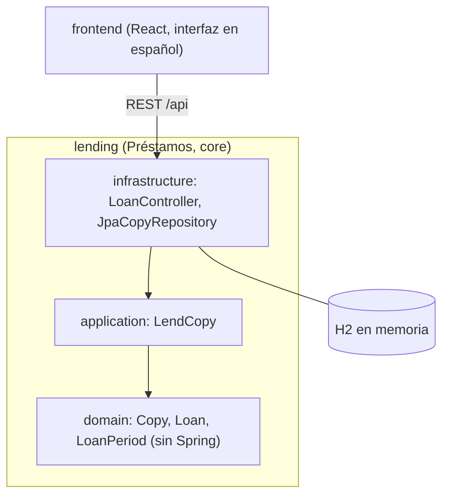

# Biblioteca UCE · Préstamos

Módulo de mostrador para prestar y devolver ejemplares en las bibliotecas de la Universidad Central del Ecuador (UCE), modelado con **Domain-Driven Design (DDD)** como **monolito modular**.

Es el proyecto de la clase demostrativa de **Arquitectura de Software**. La clase muestra cómo se arranca un monolito con DDD en IntelliJ, usando **Claude Code** con **Confluence** (dominio) y **Figma** (diseño) como contexto.

> **Fuente de verdad del dominio:** el espacio **BIB** de Confluence (páginas 0 a 14). Este repositorio implementa lo que ahí se define.

---

## Contenido

- [Idioma del proyecto](#idioma-del-proyecto)
- [Estructura del repositorio](#estructura-del-repositorio)
- [Arquitectura](#arquitectura)
- [Lenguaje ubicuo y reglas de negocio](#lenguaje-ubicuo-y-reglas-de-negocio)
- [Requisitos](#requisitos)
- [Cómo ejecutarlo](#cómo-ejecutarlo)
- [Ramas](#ramas)
- [Cómo contribuir](#cómo-contribuir)
- [Documentación y diseño](#documentación-y-diseño)
- [Estado y pendientes](#estado-y-pendientes)
- [Equipo](#equipo)

---

## Idioma del proyecto

| Ámbito | Idioma | Ejemplos |
| --- | --- | --- |
| Negocio, interfaz y documentación | **Español** | Ejemplar, Lector, Prestar, "Este ejemplar no está disponible" |
| Código, paquetes, eventos, commits | **Inglés** | `Copy`, `Member`, `lend()`, `CopyLent`, `BR-01` |

La equivalencia exacta entre ambos está en la página **5 · Lenguaje ubicuo** de Confluence (decisión ADR-007).

---

## Estructura del repositorio

```text
arqPj/
├── backend/library/            # API Spring Boot (Gradle, Groovy DSL)
│   └── src/main/java/ec/edu/uce/library/
│       ├── lending/            # Préstamos (subdominio core)
│       │   ├── domain/         # agregados, objetos de valor, eventos, puertos (sin Spring)
│       │   ├── application/    # casos de uso
│       │   └── infrastructure/ # REST, JPA, configuración
│       ├── catalog/            # Catálogo (soporte), mismas tres capas
│       └── members/            # Lectores (genérico), mismas tres capas
├── frontend/                   # React + TypeScript + Vite
├── docs/                       # copia de respaldo del Confluence y runbooks
├── CLAUDE.md                   # contexto y convenciones para Claude Code
└── runbook-clase-intellij.md   # guion de la clase demostrativa (60 min)
```

---

## Arquitectura

**Monolito modular:** un solo despliegue, con un paquete por **contexto delimitado** y tres capas dentro de cada uno.



**Reglas de la arquitectura:**

- Las dependencias apuntan **hacia adentro**: `infrastructure → application → domain`.
- `domain` es Java puro: no importa Spring, JPA ni ningún framework.
- Un contexto **no comparte clases de entidad** con otro; solo guarda sus identificadores (`MemberId`, `BookId`).
- Las **reglas de negocio viven en el agregado**, no en controladores ni servicios. El caso de uso carga el agregado, llama a su método, lo guarda y publica los eventos.

| Contexto (código) | Nombre del negocio | Tipo | Paquete |
| --- | --- | --- | --- |
| `lending` | Préstamos | Core | `ec.edu.uce.library.lending` |
| `catalog` | Catálogo | Soporte | `ec.edu.uce.library.catalog` |
| `members` | Lectores | Genérico / soporte | `ec.edu.uce.library.members` |

---

## Lenguaje ubicuo y reglas de negocio

| Negocio (pantalla) | Código |
| --- | --- |
| Ejemplar | `Copy` (agregado), `CopyId` |
| Lector | `Member`, `MemberId` |
| Obra | `Book`, `BookId` |
| Préstamo | `Loan` |
| Período de préstamo | `LoanPeriod(lentOn, dueOn)` |
| Prestar / Devolver | `Copy.lend(...)` / `Copy.returnCopy(...)` |
| Disponible | `Copy.isAvailable()` |

| Regla | Descripción | Quién la protege | Estado |
| --- | --- | --- | --- |
| `BR-01` | Un ejemplar prestado no puede volver a prestarse hasta que se devuelva | `Copy.lend` → `CopyNotAvailableException` | Implementada y probada |
| `BR-02` | La devolución de un ejemplar lo deja disponible | `Copy.returnCopy` | Implementada en el dominio y probada |
| `BR-03` | Un lector no puede tener más de tres préstamos activos | Por definir | **Tarea de la clase** |

Cada regla tiene su prueba unitaria en `domain` (JUnit 5, sin Spring), cuyo nombre empieza con el código de la regla, por ejemplo `br01_lendingALentCopyThrowsCopyNotAvailableException`.

---

## Requisitos

| Herramienta | Versión | Notas |
| --- | --- | --- |
| JDK | **25** (por ejemplo, Eclipse Temurin) | `JAVA_HOME` debe apuntar a él |
| Node.js | 22 LTS o superior | Para el frontend con Vite |
| Git | Cualquiera reciente | |
| IntelliJ IDEA | Recomendado | Licencia educativa de JetBrains |

No hace falta instalar Gradle (el proyecto trae el wrapper) ni una base de datos (usa H2 en memoria).

---

## Cómo ejecutarlo

### Backend (`backend/library`)

**Windows (PowerShell):**

```powershell
cd backend\library
.\gradlew.bat test      # pruebas
.\gradlew.bat bootRun   # API en http://localhost:8080
```

**macOS / Linux:**

```bash
cd backend/library
./gradlew test
./gradlew bootRun
```

### Frontend (`frontend`)

```bash
cd frontend
npm install
npm run dev      # http://localhost:5173 (redirige /api al puerto 8080)
npm run build    # comprobación de tipos y build de producción
npm run lint
```

### Probar la API (rama `demo/respaldo`)

Al arrancar, el backend carga los mismos ejemplares que Figma: `EJ-00123` y `EJ-00124` están disponibles y `EJ-00456` está prestado al lector `1700000004` hasta el 10/12/2026 (si esa fecha ya pasó, hasta hoy + 15 días).

```bash
# Préstamo correcto → 201 Created
curl -i -X POST http://localhost:8080/api/loans -H "Content-Type: application/json" \
  -d '{"copyCode":"EJ-00123","memberId":"1712345678","dueDate":"2026-12-08"}'

# Viola BR-01 → 409 Conflict con la fecha límite del préstamo activo
curl -i -X POST http://localhost:8080/api/loans -H "Content-Type: application/json" \
  -d '{"copyCode":"EJ-00456","memberId":"1712345678","dueDate":"2026-12-08"}'
# {"message":"The copy is not available","dueDate":"2026-12-10"}
```

---

## Ramas

| Rama | Contenido | Uso |
| --- | --- | --- |
| `main` | Versión estable | Recibe `develop` cuando hay una versión lista |
| `develop` | Estructura de paquetes vacía, H2, proxy de Vite y `CLAUDE.md` | **Punto de partida de la clase** (se programa en vivo) |
| `demo/respaldo` | Solución completa: agregado `Copy`, `LendCopy`, `POST /api/loans`, pantalla de préstamo | **Plan B** de la clase |
| `feature/*`, `docs/*`, `fix/*` | Trabajo de cada integrante | Pull request hacia `develop` |

---

## Cómo contribuir

1. Crea una rama desde `develop`: `feature/<tema>`, `docs/<tema>` o `fix/<tema>`.
2. Haz commits pequeños en inglés con **Conventional Commits**: `feat(lending): ...`, `fix(backend): ...`, `docs: ...`.
3. Los commits se hacen **desde tu propia consola**. Si usas Claude Code, pídele que edite pero no que haga commits.
4. Abre un **pull request hacia `develop`** y pide la revisión de otro integrante.
5. Antes de abrir el PR: `./gradlew test` en verde y, si tocaste el frontend, `npm run build`.
6. **Nunca subas** tokens, contraseñas, códigos de licencia ni `.claude/settings.local.json`.

---

## Documentación y diseño

| Recurso | Qué contiene |
| --- | --- |
| **Confluence**, espacio [BIB](https://josephp2001.atlassian.net/wiki/spaces/BIB) | Visión, actores, research, línea gráfica, lenguaje ubicuo, reglas, subdominios, mapa de contextos, modelo táctico, eventos, casos de uso, ADR, diseño y pruebas (páginas 0 a 14) |
| **Figma**, archivo *Biblioteca UCE* | Sistema de diseño (Atomic Design sobre Material UI), 16 pantallas de escritorio y 8 móviles con prototipo navegable |
| **FigJam**, *Biblioteca UCE · Research* | Benchmark, proto-personas, journey e hipótesis |
| [`CLAUDE.md`](CLAUDE.md) | Arquitectura, convenciones y comandos para Claude Code |
| [`runbook-clase-intellij.md`](runbook-clase-intellij.md) | Guion de la clase demostrativa |
| [`docs/`](docs) | Copia en Markdown del Confluence (plan B si el conector no funciona) y runbook del entorno |

El acceso a Confluence y a Figma está restringido al equipo.

---

## Estado y pendientes

- [x] Estructura del monolito modular por contextos
- [x] Agregado `Copy` con `BR-01` y `BR-02`, y sus pruebas
- [x] Caso de uso `LendCopy` y endpoint `POST /api/loans` (409 al violar `BR-01`)
- [ ] Caso de uso `ReturnCopy` y su endpoint (`BR-02` hoy solo existe en el dominio)
- [x] Interfaz en español, como en Figma (pantalla Prestar ejemplar con Material UI y `frontend/src/theme.ts`)
- [x] Bloqueo optimista (`@Version`) y transacción para proteger `BR-01` ante concurrencia
- [x] Códigos de ejemplo iguales a Figma (`EJ-00123`, `EJ-00124`, `EJ-00456`)
- [x] Prueba de arquitectura (ArchUnit) para los límites del monolito
- [ ] Listener de `CopyReturned` en Catalog (depende de `ReturnCopy`)
- [ ] `BR-03` (tarea de la clase)

---

## Equipo

Proyecto académico de Arquitectura de Software, Universidad Central del Ecuador.

| Integrante | Rol |
| --- | --- |
| Joseph | Coordinación, Claude Code y conectores |
| Alex | Dominio, documentación (Confluence) y diseño (Figma) |
| Juan | Código (backend y frontend) y repositorio |
